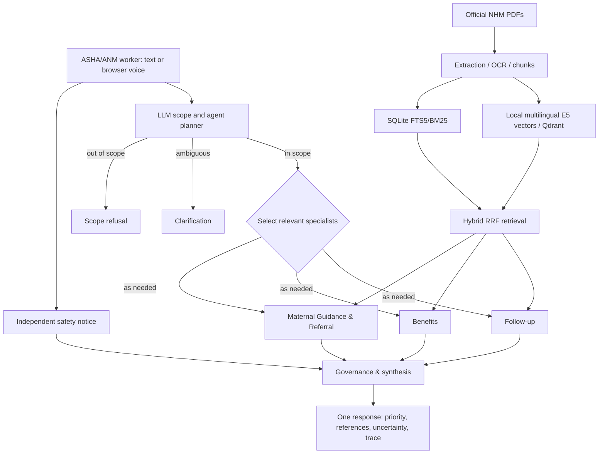

# ArogyaGuard AI: System Architecture

**Implementation reference:** Hybrid RAG V3, with V3.1 scope improvements considered. The GitHub repository should be checked against this documentation after the final code upload.

## System overview

ArogyaGuard AI is a **locally hosted, LLM-orchestrated, multi-agent retrieval application** for synthetic maternal-health scenarios. Its web interface can accept text and browser-supported voice input in English, Hindi, Telugu and Kannada. It retrieves government-source material to support human-led referral, benefits information, and follow-up.

The application **is not fully offline**: OpenRouter is used for scope assessment, routing, specialist reasoning and answer synthesis. PDF storage, lexical retrieval and optional embedding/vector retrieval run locally.

The diagram shows the **intended** behavior. A selected specialist depends on the live LLM plan and should be verified using the execution trace.

## The four agents

| Agent | Invocation pattern | Role and boundary |
|---|---|---|
| **Maternal Guidance & Referral** (`guidance`) | Maternal guidance, warning signs, referral questions | Retrieves ASHA guidance; supports timely professional assessment; **does not diagnose or prescribe** |
| **Benefits** (`benefits`) | JSSK, published entitlements, transport or access questions | Retrieves official benefits guidance; does not promise a vehicle, payment, service availability or individual eligibility |
| **Follow-up** (`followup`) | Missed ANC, high-risk tracking, post-referral continuity | Retrieves PMSMA/Extended PMSMA programme guidance; proposes human-owned follow-up steps; no automatic patient task is completed |
| **Governance & Synthesis** | Every in-scope response | Consolidates specialist findings; filters unavailable citation IDs; highlights evidence gaps, programme scope and human oversight |

The **planner is an orchestration function**, not a fifth specialist. The proposed **Knowledge Update Agent** is future work and is not part of the current four-agent implementation.

## Runtime sequence

1. **Receive request.** The web client sends a question, language, state and limited recent conversation context to the FastAPI backend.
2. **Safety backstop.** A separate conservative lexical warning checks for potential danger-sign expressions. It is not a clinically validated symptom classifier. Agent routing itself remains LLM-first.
3. **LLM planning.** OpenRouter returns a structured scope decision, selected specialists and search queries. An out-of-scope request is rejected; an ambiguous request can trigger clarification.
4. **Evidence retrieval.** For each selected specialist, approved passages are searched using FTS5/BM25 and, when indexed and operational, Qdrant embeddings. Rank lists are fused by reciprocal-rank fusion (RRF).
5. **Specialist findings.** Each specialist receives the question and retrieved passages and returns findings, human-led next steps, uncertainties and available evidence identifiers.
6. **Governance.** A mandatory in-scope synthesis stage produces one answer. Invalid model-generated citation identifiers are filtered, and unsupported situations can result in an insufficient-evidence response.
7. **Display.** The UI can present the answer, urgency notice, evidence details and a non-sensitive execution trace.

### Important routing limitation

The Follow-up Agent was invoked for a focused missed-ANC question but was **not** selected for at least one combined case involving danger signs, transport and a missed appointment. This is a known **compound-intent planning issue**. We have not established that all relevant specialists are always selected; see [DEMO_AND_EVALUATION.md](DEMO_AND_EVALUATION.md).

## Data and knowledge flow

**Approved sources:** The application source manifest is in `arogyaguard/catalog.py`. Government PDFs are not bundled into the source archive by default.

**Ingestion:** Approved PDF URL → download and verification → `pypdf` text extraction → optional Tesseract OCR for scans → page-linked passages → SQLite document store and FTS5 index.

**Optional semantic layer:** Actual PDF passages → `intfloat/multilingual-e5-small` local embeddings → local persistent Qdrant vectors. PDF indexing does **not** automatically guarantee that the vector index has been populated.

**At query time:** Lexical and semantic ranked candidates are merged using RRF (not a trained reranker). If semantic dependencies/index are unavailable, retrieval can continue in a **lexical-only** mode. The interface/status must not label this as functioning hybrid search.

**Evidence limitation:** An existing evidence ID and a PDF page are provenance checks, not proof that a generated claim is entailed by that passage.

## Implementation components

| Area | Reference in the V3 project |
|---|---|
| Web / API | `web/`, `arogyaguard/api.py`, `run.py` |
| LLM planner and agent execution | `arogyaguard/engine.py`, `arogyaguard/prompts.py` |
| Typed plan, findings and response | `arogyaguard/models.py` |
| Safety notice | `arogyaguard/safety.py` |
| Approved source list | `arogyaguard/catalog.py` |
| Parsing and SQLite indexing | `arogyaguard/knowledge.py` |
| FTS5 and RRF retrieval | `arogyaguard/hybrid.py` |
| Local embeddings and Qdrant | `arogyaguard/vectors.py` |
| Document sync | `scripts/sync_sources.py` |
| Embedding build | `scripts/build_vectors.py` |
| Optional graph execution | `requirements-langgraph.txt` (if installed) |

The implementation supports Python `asyncio` specialist execution and may use an optional LangGraph adapter. **LangGraph is not a mandatory runtime dependency for every installation.**

## Inspection endpoints (V3)

| Endpoint | Purpose | Interpretation |
|---|---|---|
| `GET /api/status` | Application version, languages, model-key presence, retrieval status | `model_ready` indicates a configured key, **not** a successful live model call |
| `GET /api/sources` | Approved source metadata and indexed/vector passage counts | Verify real per-document indexing, rather than assuming source coverage |
| `POST /api/ask` | LLM-routed user query | Inspect actual `agents_used`, source evidence and `trace` |
| `POST /api/safety` | Standalone early safety notice | Heuristic support, not clinical triage validation |
| `POST /api/sources/{document_id}/sync` | Index one allow-listed PDF | Extraction may require OCR; vector indexing has separate status |
| `POST /api/vectors/build` | Build/rebuild local embeddings | Requires hybrid dependencies and indexed PDF passages |

## Security, privacy and human control

- Use **synthetic cases only**. Do not send identifiable patient information to external LLM services in this demo.
- The basic API includes limited input screening, but **is not a complete privacy or authentication system**.
- Source documents can contain untrusted text. They should never be executed as instructions to change system behavior.
- The application does not book ambulances, contact health facilities, create verified patient records, prescribe medication or make autonomous clinical decisions.
- Local document storage does not make OpenRouter inference offline. Use authenticated roles, security review and appropriate data protection before any field deployment.

## Future enhancements (not yet implemented)

- **Knowledge Update Agent:** after the first round, explore monitoring official government sources, detecting changes, and proposing **human-verified** knowledge-base updates.
- Broader testing for multi-intent routing, regional-language safety, OCR quality, state applicability, and claim-to-source correctness.
- A reviewed workflow for human confirmation of referrals and follow-up rather than treating suggestions as completed actions.

Related: [MAP.md](MAP.md) · [DEMO_AND_EVALUATION.md](DEMO_AND_EVALUATION.md) · [SOURCES_AND_LIMITATIONS.md](SOURCES_AND_LIMITATIONS.md)
