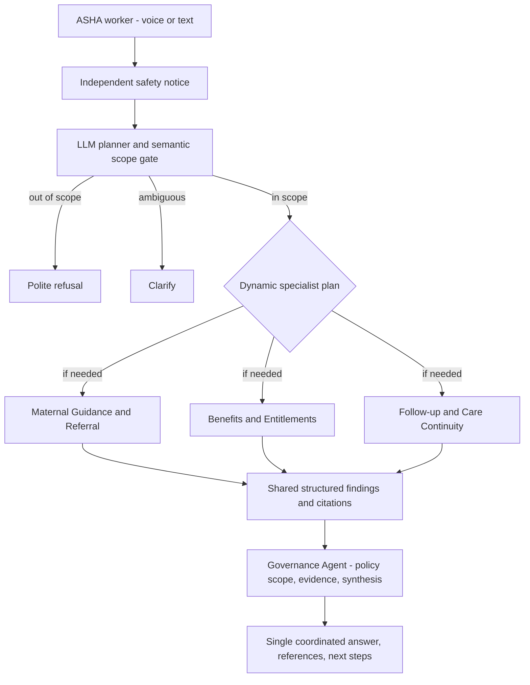

# Agentic architecture and evaluation notes

## Prompt responsibilities

- Planner: Is the *meaning* in maternal-health scope? What specialists have to work? What English source queries should each run? Produces a JSON plan, no answer.
- Guidance: Answers routine ANC guidance/ASHA responsibilities and supports danger sign/referral interpretation from ASHA training documents; no individual diagnosis.
- Benefits: Reads JSSK and applicable source passages for entitlements, transport and care access; no live service guarantees.
- Follow-up: Reads PMSMA/extended PMSMA; checks missed visits, outcomes, continuity and local applicability. No case action without human confirmation.
- Governance: Receives grounded specialist findings with *actual evidence IDs*, produces one answer in the chosen language, checks policy provenance and caveats; is always invoked for in-scope questions.

## Information boundaries

- Input: question, language, requested state, up to six recent conversation messages. **No personal records**.
- Planner output: `ExecutionPlan(scope, agents, search_queries, rationale, clarification)`.
- Specialist inputs: user question + semantic query + source excerpt IDs/page/scope.
- Specialist output: `SpecialistFinding(summary, actions, evidence_ids, uncertainties)`.
- Governance output: `GovernedAnswer(answer, steps, citation_ids, caveats, status)`.
- API output: consolidated answer, validated citations, non-sensitive trace, urgency notice. No chain-of-thought is exposed.

## Trust and evidence

Only `SOURCES` fixed allow-list URLs can be indexed. The app downloads PDF bytes and validates `%PDF-`, host and maximum size. `pypdf` (plus optional Tesseract OCR) extracts individual pages and chunks with overlap; SQLite FTS5 indexes exact terms and Qdrant optionally indexes multilingual-E5 semantic vectors. The LLM creates the *actual* retrieval query. If evidence is missing, specialists report that. PDF source pages are never invented. All source text is treated as untrusted content. Governance validates citation IDs and removes unsupported generated IDs. However it is not a substitute for clinical validation or semantic entailment checks.

## Critical limits / next engineering work

1. Replace demo-only token screening with tested, clinically reviewed multilingual emergency detection, including explicit negation and question-vs-symptom distinction.
2. Create a labeled evaluation suite of 100+ real-world ASHA questions with expected agent set, verified NHM citations, and out-of-scope/ambiguous cases; use only synthetic cases.
3. Benchmark and improve the newly added multilingual-E5 semantic retrieval for Hindi/Telugu/Kannada. Current fusion uses reciprocal-rank fusion; a trained cross-encoder reranker could be investigated later.
4. Measure LLM cost, p50/p95 response latency, unsupported assertions, state-specific entitlements and speech accuracy.
5. Add authenticated health-worker roles, encryption and a privacy/security review before any real patient use.
6. Source update monitoring/AutoSync is Phase 2 requiring approval before a new document version becomes active.

Current first-round demo deliberately avoids the implication that downloaded PDFs automatically establish state-specific policy entitlements or clinical decision support.
