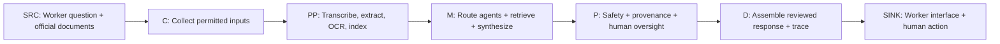

# ArogyaGuard AI: ITU-T Y.3172 and AI Readiness Mapping

**Project:** ArogyaGuard AI  
**Team:** RITAM  
**Use case:** Maternal-health information support for frontline workers in India  
**Status:** Prototype architecture mapping, not standards certification

## Why this mapping exists

The AI for Good Lab Hackathon asks teams to connect an AI use case to **ITU-T Y.3172**, **AI Readiness 2.0**, and applicable national policies. ITU-T Y.3172 describes an ML architecture for future networks, not a healthcare certification programme. We **adapt its seven logical pipeline nodes as an analysis framework** to identify where our application needs stronger evidence, governance, evaluation, and human oversight.

AI Readiness terms in this document are **assessment lenses**, not official readiness scores or a claim that the ITU has evaluated ArogyaGuard AI. The readiness report discusses dimensions such as data, digital infrastructure, digital skills, innovation ecosystem, AI policy, and implementation.

## Complete seven-node mapping

| Y.3172 node | What the node means | ArogyaGuard AI mapping | AI Readiness lens | Relevant Indian guidance / responsibility | Gap or question to investigate |
|---|---|---|---|---|---|
| **SRC — Source** | Origin of input data | An ASHA worker's text or voice question; approved NHM, ASHA, JSSK, PMSMA, Extended PMSMA, and SUMAN documents | **Data:** accessibility, provenance, representativeness | NHM/ASHA guidance; publishing programme authorities | Are the source, publication date, issuing authority, jurisdiction, and intended audience identifiable? |
| **C — Collector** | Collects information from one or more sources | Web input; limited question context; approved document download and ingestion | **Data governance; digital infrastructure:** permitted collection and connectivity | Privacy and data-minimization considerations; source ownership | Is only necessary context collected? Does the workflow distinguish a synthetic demo question from real patient data? |
| **PP — Preprocessor** | Makes collected data suitable for model use | Browser-dependent transcription; PDF extraction; optional OCR; page-preserving chunks; local SQLite FTS5 indexing; optional embeddings | **Data:** quality and interoperability; **skills:** document review | NHM source documents, original PDF page/version, programme and state scope | How are OCR errors, outdated versions, ambiguous eligibility language, and missing metadata detected and corrected? |
| **M — Model** | Produces model-based inferences or outputs | OpenRouter LLM scope assessment and agent selection; specialist evidence-grounded reasoning; lexical/semantic retrieval; synthesis | **AI evaluation; digital infrastructure:** robustness, access to AI, model and retrieval quality | ASHA referral guidance; JSSK entitlements; PMSMA and SUMAN scope | Can the orchestrator identify *all* relevant needs, including follow-up in a combined urgent referral/transport question? Are retrieval and response accuracy tested by language? |
| **P — Policy** | Applies policies or rules to model outputs | Independent warning for possible danger signs; mandatory Governance synthesis; citation-ID filtering; uncertainty and human-review boundaries | **AI policy and implementation:** accountability, oversight, safeguards | Human clinical responsibility; programme eligibility and jurisdiction; privacy obligations | Can each claim be checked against its actual source? When must the system abstain, escalate, or request human confirmation? |
| **D — Distributor** | Directs approved outputs to intended recipients | Consolidates specialist findings, relevant evidence, safety notice, and trace into a single application response | **Implementation and interoperability:** traceability, operational coordination | ASHA/ANM referral workflow; facility confirmation and follow-up responsibilities | Can reviewers see which specialists were actually invoked, which evidence they used, and what remains unverified? |
| **SINK — Sink** | Receives and acts upon pipeline outputs | ASHA-facing web interface with text, language selection and browser-dependent voice; a human decides subsequent action | **Digital skills; inclusion; usability:** accessibility and comprehension | NHM ASHA responsibilities; local service delivery | Do users understand urgency, limitations and source scope in English, Hindi, Telugu and Kannada? Can they distinguish advice from an action already completed? |

### The pipeline at a glance

This diagram simplifies the architecture for mapping purposes. In the actual prototype, the **independent danger-sign warning can be surfaced before the LLM completes**, rather than waiting until the sequential P node.

## A representative mapped workflow

**Synthetic case:** Lakshmi, eight months pregnant, has severe headache and blurred vision, missed an ANC appointment, and faces a transport barrier.

1. **SRC/C:** Receive a synthetic ASHA question and identify the relevant approved document sources.
2. **PP:** Retrieve indexed, page-attributed passages; verify OCR quality and review unclear speech transcripts.
3. **M:** The intended route selects Maternal Guidance, Benefits and Follow-up. **This full combination is not yet consistently demonstrated**; the Follow-up Agent has worked independently but has been omitted from at least one combined question.
4. **P:** Highlight potential danger signs immediately, avoid diagnosis, qualify benefit applicability and require human follow-through.
5. **D/SINK:** Present one prioritized answer, citations and a trace where available. Neither a referral nor transport is automatically booked.

## Mapping observed evidence to candidate gaps

| Prototype evidence or known limitation | Nodes | Candidate gap for investigation | Proposed standardization / implementation response |
|---|---|---|---|
| JSSK scanned-PDF extraction required attention; source information spans programmes | SRC, C, PP | Inconsistent machine-readable policy records and provenance | Publish reviewed structured records with programme, source, page, version, date, jurisdiction and entitlement conditions |
| SUMAN and PMSMA questions were incorrectly classified as out of scope in prior tests | M, D | Incomplete maternal-health topic coverage and route explainability | Reviewed topic taxonomy, synonym coverage and logged routing evaluations |
| Follow-up works alone but was not always selected alongside urgent referral and transport | M, D | Compound-intent and multi-agent completeness | Evaluate the selected specialist set against labeled multi-need cases; preserve urgency priority |
| Exact local benefit or state rollout cannot always be verified | SRC, P | Weak machine-readable jurisdiction and implementation metadata | Store national/state/phase conditions explicitly; defer unverified local eligibility |
| A citation ID may refer to a real passage without supporting every sentence | P, D | Claim-level verifiability | Evaluate assertion-to-evidence support, not only citation existence |
| Four languages supported, with informal English advantage and online LLM dependency | M, SINK | Language-specific readiness and accessibility | Matched multilingual safety tests, speech verification, realistic connectivity assessment |

These are **proposed gaps to examine**, not findings that a national policy or ITU standard is deficient. Prototype bugs alone do not prove a standards gap.

## Readiness assessment: what can and cannot be claimed

| Area | Current evidence | Still needed |
|---|---|---|
| Data | Approved-source list; local document indexing; source attribution where indexed | Reviewed OCR, version dates, applicability metadata and source completeness |
| Infrastructure | Local FastAPI/web app; local SQLite; optional Qdrant | Verified setup across machines, connectivity/latency evaluation and secure deployment design |
| Access and inclusion | English, Hindi, Telugu and Kannada text/voice interface | Structured parity and usability tests, especially for regional-language danger-sign questions |
| Governance | Safety notice, source-ID checks, uncertainty instructions and human-led actions | Clinical review, claim-level checks, privacy/security assessment and escalation procedures |
| Implementation | Working prototype and example tests | Larger labeled evaluations, reproducible metrics, operational monitoring and field authorization |

## Primary references

- [ITU-T Y.3172 Recommendation (2019)](https://www.itu.int/ITU-T/recommendations/rec.aspx?id=13894)
- [ITU: AI Ready, Analysis Towards a Standardized Readiness Framework](https://www.itu.int/epublications/publication/ai-ready-analysis-towards-a-standardized-readiness-framework)
- [NHM: Maternal Health](https://nhm.gov.in/images/pdf/guidelines/nrhm-guidelines/family-planning/index1.php?lang=1&level=2&lid=218&sublinkid=822)
- [NHM: JSSK programme](https://nhm.gov.in/index4.php?lang=1&level=0&lid=171&linkid=150)
- For the actual PDFs and programme-specific cautions, see [SOURCES_AND_LIMITATIONS.md](SOURCES_AND_LIMITATIONS.md).

**Interpretation note:** Y.3172's names for C, PP, M, P, D and SINK are architectural roles. The healthcare mappings, Readiness lenses and policy questions here are **Team RITAM's adaptation**, not official ITU node-to-healthcare requirements.
